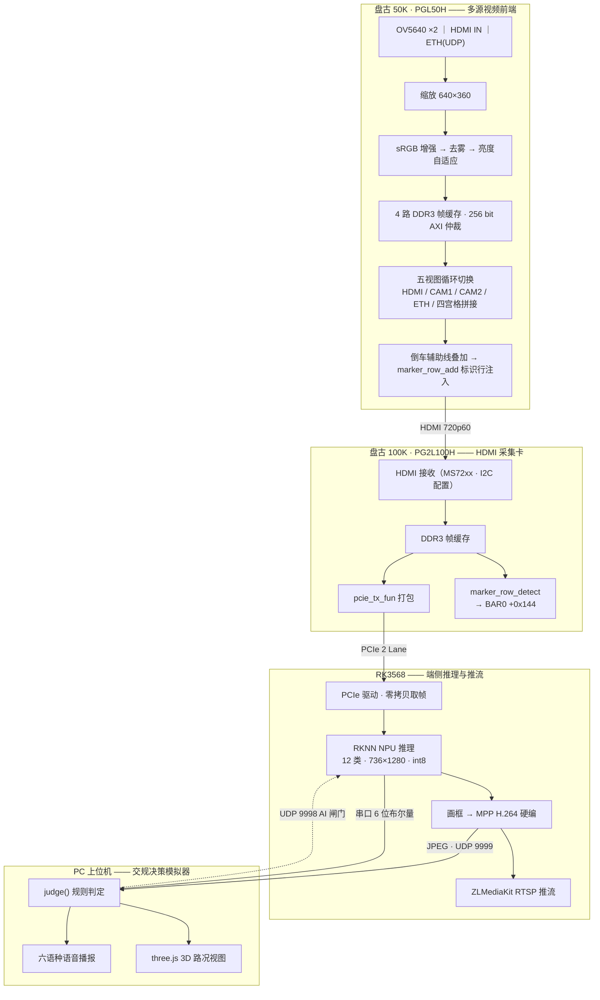

<div align="center">

# FPGA 创新设计竞赛 · 紫光同创赛道
## 参赛组号：46867

# 基于 PGL50H + PG2L100H 双 FPGA 的
# 智能交通路况感知与交规决策演示系统

多路视频采集 · FPGA 实时拼接 · PCIe 高速上传 · NPU 端侧识别 · 交规判定与人声播报


</div>

---

> **赛事信息**：本仓库为 **FPGA 创新设计竞赛（紫光同创赛道）** 参赛作品，**组号 46867**。
> 平台为紫光同创 Logos / Logos2 系列 FPGA（盘古 50K `PGL50H`、盘古 100K `PG2L100H`），
> 开发工具 Pango Design Suite 2022.2-SP6.4。

---

## 一、项目简介

本项目做的是一个**端到端的智能交通演示系统**：把车载视角的多路摄像头 / HDMI / 网络视频送进 FPGA，
在 FPGA 内完成缩放、画质增强、多画面拼接和倒车辅助线叠加，再把结果通过 **PCIe** 送进 RK3568，
由 NPU 跑 YOLO 类交通要素检测（车道线、信号灯、斑马线等），识别结果回传 PC 上位机，
上位机按《道路交通安全法》做**交规合规判定**并给出多语种语音播报和 3D 路况视图。

整条链路**全程硬件加速**：FPGA 负责像素级实时处理与帧缓存，RK3568 的 NPU 负责推理，
MPP 硬件编码负责推流，CPU 只做调度。

### 系统架构



### 硬件与软件环境

| 角色 | 器件 / 平台 | 说明 |
|---|---|---|
| 视频前端 | 盘古 50K 开发板，**PGL50H**（Logos） | 4 路视频接入、拼接、720p 输出 |
| 采集上传 | 盘古 100K 开发板，**PG2L100H**（Logos2） | HDMI 接收 + PCIe x2 DMA |
| 边缘计算 | **RK3568**（内置 NPU） | YOLO 推理、硬件编码、推流 |
| 上位机 | Windows PC + Python 3.10+ | 交规判定、播报、3D 视图 |
| FPGA 工具 | Pango Design Suite **2022.2-SP6.4** | 综合用 Synplify Pro |
| 模型工具 | ultralytics + RKNN-Toolkit2 2.x（WSL Ubuntu 22.04） | PT → ONNX → RKNN int8 |

---

## 二、仓库结构

```
FPGA_46867/
├── FPGA_50H_100H/                     # 两套 PDS 工程
│   ├── 50H_OV5640_HDMI_ETH_USBCTL/    # 盘古50K：多源视频前端（顶层 hdmi_ddr_ov5640_top）
│   │   ├── 50H_OV5640_HDMI_ETHERNET.pds
│   │   ├── hdmi_ddr_ov5640_top.fdc    # 引脚/时序约束
│   │   ├── source/rtl/                # 自研 RTL（见下表）
│   │   ├── source/rtl/DDR3_50H/       # 厂商 DDR3 PHY/控制器 IP
│   │   ├── source/rtl/eth/            # 自研 UDP/IP/MAC 协议栈 + ARP/ICMP
│   │   └── generate_bitstream/*.sbit  # 已编译码流（可直接烧录）
│   └── HDMI_PCIe/                     # 盘古100K：HDMI→PCIe 采集卡（顶层 hdmi_loop）
│       ├── HDMI_PCIe.pds
│       ├── src/                       # 帧缓存、PCIe 打包、标识行检测、I2C 配置
│       ├── src/pcie/                  # pcie_tx_fun / pio_crtl / DMA 控制
│       ├── ipcore/                    # 厂商 PCIe / DDR3 / PLL / FIFO IP
│       └── generate_bitstream/*.sbit  # 已编译码流
│
└── ARM_HOST/                          # RK3568 与 PC 侧
    ├── BLP-7/                         # YOLO 训练产物（args.yaml / results.csv / weights）
    ├── RK/                            # RK3568 端
    │   ├── cpp/                       # 板端 C++（CMake）：采集→推理→画框→推流→串口
    │   ├── driver/                    # PCIe 采集驱动源码（可重编 .ko）
    │   ├── model/*.rknn               # 当前在用 NPU 模型（12 类，int8）
    │   ├── convert_bl3.py             # PT→ONNX→RKNN 量化转换
    │   └── v8_start.py / push_and_build.py / start_auto_drive.bat
    └── 上位机/                         # PC 交规决策模拟器
        ├── traffic_rules_sim.py       # 主程序（Tkinter + 判定内核 + 串口/UDP）
        ├── voice_prompts.py           # 六语种语音词库与播报调度
        ├── smoke_test.py              # 26 组冒烟测试
        ├── 规则矩阵.md                 # 判定矩阵与法律依据
        └── 3D/                        # WebView2 + three.js 3D 路况页面（离线可用）
```

> 编译流水线目录（`compile/ place_route/ report_timing/ synthesize/ device_map/`）中的中间产物
> 未入库，仅保留 `device_map/*.pcf` 引脚约束表和 `generate_bitstream/*.sbit` 码流，详见 `.gitignore`。

---

## 三、核心实现要点

### 3.1 盘古 50K —— 多源视频前端

| 模块 | 作用 |
|---|---|
| `video_scale_process` | 4 路输入统一缩放到 640×360（拼接用） |
| `image_enhance` | RGB565 的 **sRGB 传递函数**（IEC 61966-2-1），替代原 Gamma 1.5，暗部不放大噪声 |
| `defog_rgb` | 去雾，逐像素延迟对齐 |
| `luma_adapt` | 亮度自适应/夜景链路，固定 15 拍延迟，**几何零漂移** |
| `frame_read_write` ×4 + `mem_read_arbi/mem_write_arbi` | 4 路独立 DDR3 帧缓存 + 256 bit AXI 读写仲裁 |
| `video_rect_read_data` ×4 | 四宫格拼接取数 |
| `reverse_aux_lines` | 倒车辅助线，几何按 y 的**纯函数**逐行直算（不用累加器，避免误差累积） |
| `marker_row_add` | 每帧第 0 行注入纯色标识：白=拼接帧 / 黑=单路帧 |
| `encoder` + `uart_key_ctrl` | 按键 / 串口 `'0'` 触发五视图循环切换；串口 `'1'~'3'` 切换增强、去雾、中值 |

**五视图循环**：`HDMI → CAM1 → CAM2 → ETH → 四宫格拼接 → HDMI`。

### 3.2 盘古 100K —— HDMI→PCIe 采集卡

- **`pcie_tx_fun`**：像素流 → PCIe DMA 包（1280×720，16 bit），跨时钟域严格走厂商异步 FIFO，
  包计数用**格雷码**过两级触发器，避免多比特亚稳态。
- **`marker_row_detect` / `marker_row_blanker`**：与 50H 的 `marker_row_add` 配对。
  读侧识别第 0 行，判定当前帧是拼接还是单路，结果锁进 **BAR0 `+0x144 MARKER_STATUS`**
  （bit0 模式 / bit1 本帧成功 / bit3 读到即清的「新判决」标志 / bit15:4 计数低 12 位、bit31 恒 1 供驱动探测），
  同时把标识行涂黑，保证不会显示到画面上。
- **`pio_crtl`**：PIO 寄存器窗口，`WR_FRAME_DONE = 0x140` 等帧同步状态供 RK3568 轮询。

### 3.3 RK3568 —— 端侧推理与推流

- PCIe 采集：`pango_pci_driver.ko` + 用户态零拷贝取帧。
- 推理：`adas_detector` 用 `rknn_create_mem` + `rknn_set_io_mem` **零拷贝**提交，
  模型 `adas12n7_736x1280_i8_scaled.rknn`（12 类，int8，输入 736×1280）。
- 编码推流：MPP 硬件 H.264 → ZLMediaKit RTSP；同时 JPEG 分片经 UDP 9999 送 PC。
- 双上下文 worker（`ADAS_WORKERS=2` 默认），支持 AI 识别闸门（UDP 9998 收 `AI 0/1`），
  暂停时画面不留残框。

### 3.4 PC 上位机 —— 交规决策模拟器 v3.25.0

- 串口 **A 通道**（RK3568）收 6 位布尔量，**B 通道**（盘古 50K）只记日志不参与判定。
  位定义：`bit0` 左道线实线 / `bit1` 右道线实线 / `bit2` 直行灯 / `bit3` 左转灯 / `bit4` 右转灯 / `bit5` 斑马线。
- `judge(action, state)` 查表判定，违规只做**语音提醒 + 状态条闪烁**，不锁按钮。
- 语音六语种；优先 edge-tts，缺失时降级 Windows SAPI，再降级蜂鸣。
- 自带 **91 项规则自测**（`--selftest`）与 **26 组冒烟测试**，全部通过。

| 动作 | 左道线实线 | 右道线实线 | 直行灯非绿 | 左转灯非绿 | 右转灯非绿 | 前方斑马线 |
|:----:|:--:|:--:|:--:|:--:|:--:|:--:|
| 直行 | — | — | **违规** | — | — | 仅提示 |
| 左转 | **违规** | — | — | **违规** | — | 仅提示 |
| 右转 | — | **违规** | — | — | **违规** | 仅提示 |

法律依据：《道路交通安全法》第 38 / 90 条（禁止标线、信号灯）、第 47 条（人行横道，仅提示）。

---

## 四、如何使用

### 4.0 网络与串口约定

| 项目 | 取值 |
|---|---|
| RK3568 地址 | `192.168.137.100`（用户名/密码 `linaro`） |
| PC 网卡 | 静态 IP `192.168.137.1` |
| 串口 | PC `COM10`（CH340），115200-8-N-1，无流控 |
| 视频 | UDP **9999** 收板端 JPEG 分片 |
| 控制 | UDP **9998** 下发 `AI 0` / `AI 1` |

### 4.1 编译并下载 FPGA（PDS 2022.2-SP6.4）

两套工程互相独立，按板卡分别打开：

```
FPGA_50H_100H/50H_OV5640_HDMI_ETH_USBCTL/50H_OV5640_HDMI_ETHERNET.pds   → 盘古50K
FPGA_50H_100H/HDMI_PCIe/HDMI_PCIe.pds                                   → 盘古100K
```

1. 用 PDS 打开对应 `.pds`；
2. 依次执行 Synthesize → Device Map → Place & Route → Generate Bitstream；
3. 下载 `.sbit`，或直接烧写仓库内已编译好的
   `generate_bitstream/hdmi_ddr_ov5640_top.sbit`（50K）与 `generate_bitstream/hdmi_loop.sbit`（100K）。

> ⚠️ `.pds` 里记录了综合器绝对路径 `D:\Program Files\pango\PDS_2022.2-SP6.4\syn\bin\synplify_pro.exe`。
> 若 PDS 装在别处，请改 `.pds` 中该行及 `impl.tcl` 里对应的 `synthesize -dir {...}`。
> 仓库未收录 `imports/` 下的路径软链，PDS 会自动重建。

### 4.2 启动上位机（PC）

```bat
cd ARM_HOST\上位机
python -m venv .venv
.venv\Scripts\activate
pip install -r requirements.txt
python traffic_rules_sim.py            :: 或直接双击「启动模拟器.bat」
```

自检：

```bat
python traffic_rules_sim.py --selftest   :: 91 项规则自测
python smoke_test.py                     :: 26 组冒烟测试
```

### 4.3 启动 RK3568 端

PC 侧只依赖 `paramiko`：

```bash
pip install paramiko
```

```bash
cd ARM_HOST/RK
python v8_start.py start      # start | restart | stop | status
python push_and_build.py      # 改了 cpp/ 之后：推送源码 + 远程 cmake/make + 重启
```

板端首次需要加载采集驱动：

```bash
insmod pango_pci_driver.ko
```

### 4.4 一键联调

```
双击 ARM_HOST/RK/start_auto_drive.bat
```

会依次拉起 RK 端主程序、HDMI 本地显示、PC 上位机模拟器。
**注意**：`start_auto_drive.bat` 用 `..\上位机` 找上位机目录，因此 `RK` 与 `上位机`
必须位于同一父目录（本仓库结构已满足）。

### 4.5 重新训练 / 转换模型（可选）

```bash
# 1) 训练：ultralytics YOLO，12 类，imgsz=1280，80 epoch（产物见 BLP-7/）
# 2) 导出 ONNX（end2end=False，置信度预乘）
python ARM_HOST/RK/export_bl3_onnx.py
# 3) 量化转 RKNN int8 —— 在 WSL Ubuntu 22.04 内（rknn-toolkit2 2.x）
python ARM_HOST/RK/convert_bl3.py
```

Windows 下可直接双击 `转换BL3模型.bat` / `诊断WSL环境.bat`。
**这两个 bat 里写死了 `PROJ=/mnt/c/Users/Lenovo/Desktop/RK`，换机器必须同步改路径。**
bat 文件保持 **GBK 编码 + CRLF 换行**，改完不要存成 UTF-8。

---

## 五、目录与文件速查

| 想找什么 | 去哪 |
|---|---|
| 拼接/显示链 RTL | `FPGA_50H_100H/50H_OV5640_HDMI_ETH_USBCTL/source/rtl/` |
| UDP/IP/MAC 协议栈 | `.../source/rtl/eth/` |
| 引脚约束 | `.../hdmi_ddr_ov5640_top.fdc` |
| PCIe 打包与寄存器 | `FPGA_50H_100H/HDMI_PCIe/src/pcie/` |
| 标识行收发 | `marker_row_add.v`（50K）/ `marker_row_detect.v`（100K） |
| 板端主程序 | `ARM_HOST/RK/cpp/main.cc` |
| 推理封装 | `ARM_HOST/RK/cpp/adas_detector.cc` |
| PCIe 驱动 | `ARM_HOST/RK/driver/pango_pci_driver.c` |
| 判定内核 | `ARM_HOST/上位机/traffic_rules_sim.py` 的 `judge()` |
| 判定规则文档 | `ARM_HOST/上位机/规则矩阵.md` |
| 完整使用说明 | `ARM_HOST/上位机/使用说明.txt`、`ARM_HOST/RK/说明.txt` |

---

## 六、使用授权说明

**Copyright © 2026 FPGA 创新设计竞赛紫光同创赛道参赛组 46867. All rights reserved.**

本仓库为参赛作品的代码存档，供评审、学习与交流使用。

**允许**
- 个人学习、课堂教学、非商业性学术研究中使用、复制与修改；
- 转载、引用本仓库的代码或设计思路，但须注明出处并附本仓库地址。

**需事先获得书面授权**
- 任何商业用途，包括但不限于产品集成、项目交付、对外销售、企业内部生产环境使用；
- 将本作品的全部或部分代码用于其他竞赛、毕业设计、论文或项目，并作为原创成果提交；
- 以本作品为基础提供有偿技术服务或培训。

**第三方组件声明**

以下内容版权归各自所有者，遵循其原始许可，不在上述授权范围内：

| 组件 | 位置 | 许可归属 |
|---|---|---|
| 紫光同创 DDR3 / PCIe / PLL / FIFO IP | `*/ipcore/`、`*/source/rtl/DDR3_50H/` | Pango Design Suite 授权条款 |
| ZLMediaKit | `ARM_HOST/RK/cpp/ZLMediaKit/` | MIT |
| three.js r152 | `ARM_HOST/上位机/3D/three.min.js` | MIT |
| Microsoft WebView2 运行库 | `ARM_HOST/上位机/3D/webview2/` | Microsoft 许可 |
| Ultralytics YOLO | 仅训练时使用（本仓库只存放 `BLP-7/` 训练产物） | AGPL-3.0 |
| RKNN-Toolkit2 / RKNPU2 / MPP | 板端运行库，未入库 | Rockchip SDK 许可 |

本仓库按「现状」提供，不含任何明示或暗示的担保。硬件操作（烧录、接线、供电）请遵循开发板手册，
因使用本代码造成的器件损坏或数据丢失，作者不承担责任。

授权申请请通过仓库 Issue 或 GitHub [@zfl-it](https://github.com/zfl-it) 联系。

---

<div align="center">

**FPGA 创新设计竞赛 · 紫光同创赛道 · 组号 46867**

</div>
